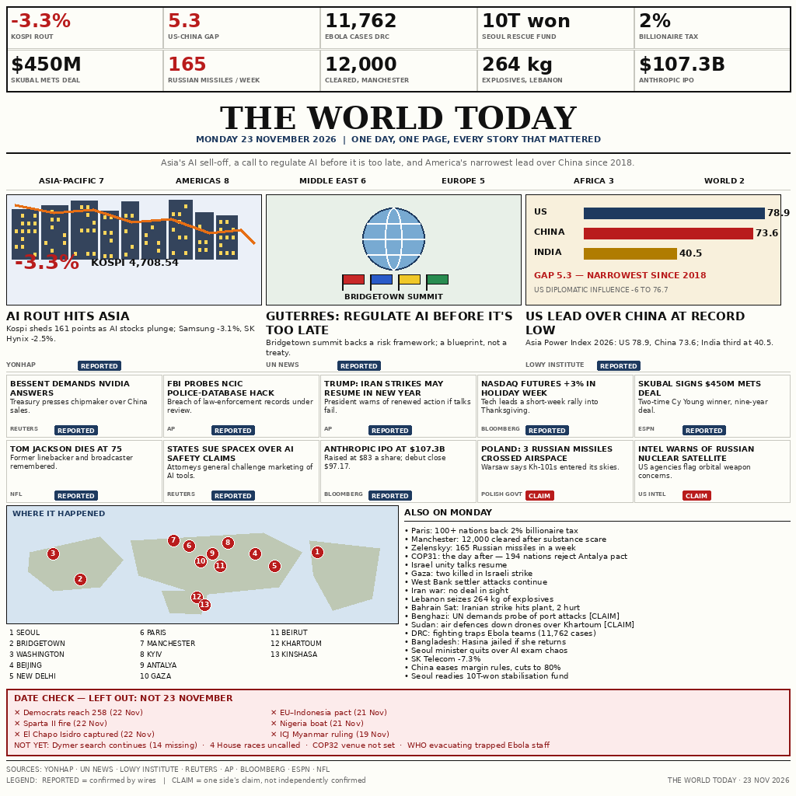

# THE WORLD TODAY — Monday 23 November 2026

[](https://make.fun/bounty/news-image-20261123?utm_source=github&utm_medium=readme&utm_campaign=news-image-20261123)
[](https://make.fun/bounty/news-image-20261123/leaderboard?utm_source=github&utm_medium=readme&utm_campaign=news-image-20261123)
[](https://make.fun/bounty/news-image-20261123?utm_source=github&utm_medium=readme&utm_campaign=news-image-20261123)

One image summing up 23 November 2026's world news — numbers-led edition: the day's ten biggest numbers first, then the masthead, three hero stories, ten cards, a world map, the full list, and a date check.



## The day in numbers

| Number | Story |
|---|---|
| −3.3% | Kospi rout — closes 4,708.54, sheds 161 points |
| 5.3 | US lead over China, narrowest since 2018 |
| 11,762 | Ebola cases in the DRC |
| 10T won | Seoul stabilisation fund |
| 2% | Billionaire tax backed by 100+ nations in Paris |
| $450M | Skubal's Mets deal — largest ever for a pitcher |
| 165 | Russian missiles in a week, per Zelenskyy |
| 12,000 | People cleared in Manchester |
| 264 kg | Explosives seized in Lebanon |
| $107.3B | Anthropic IPO, raised at $83 a share |

## How it was made

`draw.py` (Pillow) renders `entry.png` at 1024×1024. `main.py` (stdlib only) verifies the PNG and copies it to `MAKEFUN_OUTPUT_DIR/entry.png`.

```sh
python3 draw.py
MAKEFUN_OUTPUT_DIR=out python3 -P -s main.py
```
